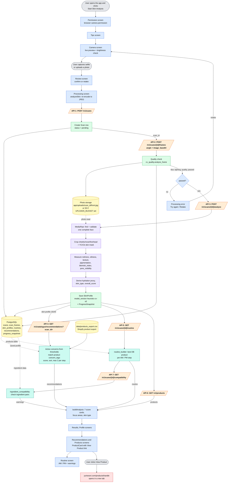
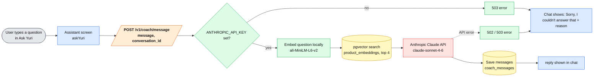

# YuriWoori AI Skin Analysis — End-to-End Process Flow

**Prepared by:** Gopal
**Source of truth:** the code in this repository (`frontend/` and `backend/`), inspected on 27 Sep 2026, including uncommitted working-copy changes.
**Scope:** the process that is actually implemented, from the moment a user opens the AI Skin Analysis until they reach a YuriWoori product page. Anything the code does not confirm is marked **"Not confirmed from the current implementation."**

---

## Contents

1. [Project overview](#1-project-overview)
2. [End-to-end process (short view)](#2-end-to-end-process-short-view)
3. [Process diagram](#3-process-diagram)
4. [Detailed step-by-step explanation](#4-detailed-step-by-step-explanation)
5. [API call identification](#5-api-call-identification)
6. [API summary table](#6-api-summary-table)
7. [Data extraction and processing](#7-data-extraction-and-processing)
8. [Skin profile generation](#8-skin-profile-generation)
9. [Product recommendation logic](#9-product-recommendation-logic)
10. [Product data flow](#10-product-data-flow)
11. [Complete data-flow table](#11-complete-data-flow-table)
12. [Final user flow](#12-final-user-flow)
13. [What happens after completion](#13-what-happens-after-completion)
14. [Current testing status](#14-current-testing-status)
15. [Ask YuriWoori status](#15-ask-yuriwoori-status)
16. [Technical architecture](#16-technical-architecture)
17. [Mentor explanation](#17-mentor-explanation)
18. [Important implementation notes](#18-important-implementation-notes)
19. [Limitations and unconfirmed items](#19-limitations-and-unconfirmed-items)

---

## 1. Project overview

| Item | Implementation | Source |
|---|---|---|
| Frontend technology | React 18 single-page app, built with Vite 6, styled with Tailwind CSS 4, animations with framer-motion | `frontend/package.json` |
| Frontend entry point | `frontend/index.html` → `src/main.jsx` → `src/App.jsx` | `frontend/index.html` |
| Frontend navigation | No router. `App.jsx` keeps the current screen in React state and moves between screens with `go(next)` | `frontend/src/App.jsx` |
| Frontend dev URL | `http://localhost:2999` (fixed port) | `frontend/vite.config.js` |
| Backend technology | Python FastAPI app, served by Uvicorn, SQLAlchemy 2 ORM, PostgreSQL + pgvector, OpenCV for image analysis | `backend/requirements.txt`, `backend/app/main.py` |
| Backend entry point | `backend/app/main.py` (`app = FastAPI(...)`), all routes mounted under `/v1` | `backend/app/main.py` |
| Backend dev URL | `http://localhost:8000/v1` | `backend/README.md`, `frontend/src/services/api.js` |
| Connection | The browser calls the backend with `fetch` and sends/receives JSON over HTTP. The base URL is `VITE_API_URL` (default `http://localhost:8000/v1`). The backend allows the frontend origin through CORS (`FRONTEND_ORIGIN`). | `frontend/src/services/api.js`, `backend/app/core/config.py` |

### Main screens (in order)

`Start → Permission → Tips → Camera → Review → Processing → Results → Profile → Recommendations → Products → Routine → Assistant ("Ask Yuri")`

### Key source files for this flow

| Layer | File | Role |
|---|---|---|
| Frontend | `src/screens/Camera.jsx`, `src/services/camera.js` | Live camera, brightness check, capture or upload |
| Frontend | `src/screens/Processing.jsx` | Starts the analysis and shows progress or an error |
| Frontend | `src/services/skinAnalysis.js` | **All** backend calls for the scan and the chat, plus mapping results into screen data |
| Frontend | `src/services/api.js` | `fetch` wrapper and error messages |
| Frontend | `src/components/ProductCard.jsx` | Product card with the "View Product" link to yuriwoori.com |
| Backend | `app/api/v1/endpoints/scans.py` | Scan, frame upload, analyze, routine, compatibility endpoints |
| Backend | `app/api/v1/endpoints/catalogue.py` | Recommendations from the CSV catalogue |
| Backend | `app/services/cv_quality.py` | Photo quality check |
| Backend | `app/services/storage.py` | Saves the photo (local disk, or S3 if configured) |
| Backend | `app/services/skin_analysis.py` | OpenCV face detection and skin metrics |
| Backend | `app/services/catalogue_csv.py` | Reads `data/products_export.csv` and ranks products |
| Backend | `app/services/recommendation.py`, `routine_builder.py`, `ingredient_compatibility.py` | Database-based routine and ingredient checks |
| Backend | `app/api/v1/endpoints/coach.py`, `app/services/coach.py`, `app/services/embeddings.py` | Ask Yuri chat |

---

## 2. End-to-end process (short view)

This is the flow as implemented. **[API]** marks a real HTTP call from the browser to the backend.

```
USER
  ↓  clicks "Start Skin Analysis"
Permission screen — browser asks for camera access (getUserMedia)
  ↓
Tips screen — lighting/framing guidance
  ↓
Camera screen — live preview, brightness check every 0.5 s
  ↓  user taps capture  (or chooses "upload a photo")
Review screen — confirm or retake
  ↓  user confirms
Processing screen → analyzeSkin(photo)
  ↓  photo re-encoded to JPEG in the browser (max side 1280 px)
[API] POST /v1/scans                               → scan_id
  ↓
[API] POST /v1/scans/{scan_id}/frames              → quality check + photo saved
  ↓  (if not passed → error, user retakes)
[API] POST /v1/scans/{scan_id}/analyze             → OpenCV face + skin analysis → skin profile saved
  ↓
[API] GET  /v1/catalogue/recommendations?scan_id=  → matched products from products_export.csv   ┐
[API] GET  /v1/scans/{scan_id}/routine             → AM / PM routine (database products)           ├ in parallel
[API] GET  /v1/products                            → database product list (for step/price/url)    ┘
  ↓  (only if routine succeeded)
[API] GET  /v1/scans/{scan_id}/compatibility       → ingredient warnings
  ↓
Frontend turns metrics into 7 score cards
  ↓
Results → Profile → Recommendations → Products → Routine screens
  ↓  user clicks "View Product" on a product card
Browser opens https://yuriwoori.com/products/{handle} in a new tab
  ↓
YuriWoori portal (external website)
```

---

## 3. Process diagram

### 3.1 Colour key

| Colour | Meaning |
|---|---|
| Grey | User action |
| Blue | Frontend (browser) |
| Orange | HTTP API call |
| Green | Backend logic |
| Purple | Image / computer-vision analysis |
| Yellow | Data store (database, CSV file, photo storage) |
| Teal | Recommendation logic |
| Red | External website or service |

### 3.2 Main skin-analysis flow (Mermaid)



> APIs 4, 5 and 6 are sent **at the same time** (`Promise.allSettled`). API 7 is sent only if API 5 succeeded. A failure in APIs 4–7 does **not** stop the results from showing.

### 3.3 Ask Yuri flow (separate from the skin analysis)



---

## 4. Detailed step-by-step explanation

### Step 1 — User opens the AI Skin Analysis (no API)
- `Start.jsx` shows **Start Skin Analysis** (goes to `permission`) and **Ask Yuri** (goes to `assistant`).
- The Start screen tells the user: *"Your photo is sent to the YuriWoori server for analysis."*

### Step 2 — Camera permission (browser API, not a backend call)
- `Permission.jsx` calls `navigator.mediaDevices.getUserMedia({ video: true })`. If allowed, it goes to `tips`. If blocked, it shows an error.

### Step 3 — Tips (no API)
- `Tips.jsx` shows lighting and framing guidance, then goes to `camera`.

### Step 4 — Camera / selfie capture (browser only)
- `Camera.jsx` opens the camera with `getUserMedia` (front camera by default, ideal 1280×1280). The user can switch to the back camera.
- **Lighting check (real, in the browser):** every 500 ms `measureBrightness()` shrinks the frame to 48×48 px and averages luminance. Light is "OK" when the average is between 70 and 215 (on a 0–255 scale).
- **Face check (simulated):** `detectFace()` waits 1.8 s and always returns `detected: true`. It does not look at the image.
- When both checks are true the oval turns green and says *"Perfect. Ready to capture."* This is only a visual hint; capturing is always allowed while the camera is live.
- **Capture:** `captureFrame()` draws the video frame onto a canvas, mirrors it and makes a JPEG data URL (quality 0.92).
- **Upload instead:** a file input (`accept="image/*"`) reads the chosen file as a data URL with `FileReader`.
- The photo is kept in React state (`photo`) and the app goes to `review`.

### Step 5 — Review (no API)
- The user either **Retakes** (back to `camera`) or confirms (goes to `processing`).

### Step 6 — Processing: photo preparation (browser only)
- `Processing.jsx` calls `analyzeSkin(photo)` from `services/skinAnalysis.js`.
- `toJpegDataUrl()` redraws the photo on a canvas so that the longest side is at most 1280 px, and re-encodes it as JPEG quality 0.92. This is needed because the backend quality check accepts only JPEG.

### Step 7 — [API 1] Create a scan
- `POST /v1/scans` with no body. The backend creates a `Scan` row (`status = pending`, `angles_captured = []`) and returns `scan_id`.

### Step 8 — [API 2] Upload the selfie and check quality
- `POST /v1/scans/{scan_id}/frames` with `{ angle: "front", image_base64: "<data URL>" }`.
- The backend runs the quality check, **saves the photo**, writes a `ScanFrame` row, and marks the angle as captured only if it passed.
- If `passed` is `false`, the frontend stops and shows: *"This photo didn't pass the quality check (sharpness X, lighting Y). Please retake it facing a soft, even light."*

### Step 9 — [API 3] Analyze the skin
- `POST /v1/scans/{scan_id}/analyze`, no body.
- The backend loads the saved photo, runs the OpenCV analysis (section 7), saves a `SkinProfile` and a `ProgressSnapshot`, sets the scan to `analyzed`, and returns the profile.
- If the same scan is analyzed again, the saved profile is returned (no duplicates).

### Step 10 — [API 4, 5, 6] Recommendations, routine and product list (in parallel)
- `GET /v1/catalogue/recommendations?scan_id=...` — matched products from the CSV catalogue (section 9).
- `GET /v1/scans/{scan_id}/routine` — AM/PM routine built from the database products table.
- `GET /v1/products` — all active database products. The frontend uses it only to look up step, price and URL for routine items.

### Step 11 — [API 7] Ingredient compatibility (only if the routine loaded)
- `GET /v1/scans/{scan_id}/compatibility` — ingredient pairs inside the routine that have a stored interaction.

### Step 12 — Build the screen model (browser only)
- `buildAnalysis()` turns the metrics into 7 score cards (section 8.3), picks the three lowest as **focus** areas and builds a one-line summary.
- Each recommended product is linked to the result areas it helps (`AREA_TAGS`).
- After a short 1.5 s delay the app goes to `results`.

### Step 13 — Results screens (no API)
- **Results:** 7 cards with a score and a status (strength / balanced / focus).
- **Profile:** skin type, overall score, focus areas and strengths.
- **Recommendations:** for each focus area, fixed guidance text (`FOCUS_GUIDANCE` in `data/mock.js`) plus up to 3 matching products. Each product appears only once, under the first focus area it helps.
- **Products:** there is no separate products screen any more; products appear only in the Routine (morning, evening and optional extras), with live prices from yuriwoori.com and Add to cart.
- **Routine:** AM and PM steps with reasons, plus compatibility warnings if any.

### Step 14 — Product redirect (no API)
- On a product card, **View Product** is a normal link: `href = product.url || "https://yuriwoori.com"`, `target="_blank"`. It opens the YuriWoori product page in a new tab.

---

## 5. API call identification

Only real HTTP endpoints are listed here. Internal Python/JavaScript functions are covered separately in 5.9.

### 5.1 [API CALL 1] Create scan

| | |
|---|---|
| **Endpoint** | `POST /v1/scans` |
| **Caller** | Frontend → Backend (`analyzeSkin()` in `skinAnalysis.js`) |
| **Request** | No body |
| **Backend work** | Inserts a `Scan` row: `status = pending`, `angles_captured = []`, `user_id = null` |
| **Response** | `{ "scan_id": "<uuid>" }` |
| **Next** | The frontend uses `scan_id` for every later call |
| **Errors** | `503` if the database is unavailable |

### 5.2 [API CALL 2] Upload frame (selfie)

| | |
|---|---|
| **Endpoint** | `POST /v1/scans/{scan_id}/frames` |
| **Caller** | Frontend → Backend |
| **Request** | `{ "angle": "front", "image_base64": "data:image/jpeg;base64,..." }` — `angle` must match `^[A-Za-z0-9_-]{1,32}$`; `image_base64` is at most 14,000,000 characters (~10 MB image) |
| **Backend work** | 1) `cv_quality.analyze_frame()` scores the image. 2) Base64 is decoded. 3) `storage.save_frame()` saves the JPEG. 4) A `ScanFrame` row is saved with the scores. 5) If passed, `"front"` is added to `scan.angles_captured`. |
| **Response** | `{ frame_id, angle, blur_score, lighting_score, quality_score, passed }` |
| **Next** | `passed = true` → API 3. `passed = false` → the frontend shows a retake error |
| **Errors** | `404` scan not found, `400` invalid base64, `422` invalid body |

### 5.3 [API CALL 3] Analyze skin

| | |
|---|---|
| **Endpoint** | `POST /v1/scans/{scan_id}/analyze` |
| **Caller** | Frontend → Backend |
| **Request** | No body |
| **Backend work** | Loads the passed frames from storage, runs `skin_analysis.analyze_skin_profile()`, saves `SkinProfile` (`model_version = "heuristic-cv-v0"`) and `ProgressSnapshot`, sets scan `status = analyzed` |
| **Response** | `{ scan_id, skin_type, hydration, oiliness, texture, redness, pigmentation, blemish_index, pore_visibility, overall_score, model_version }` |
| **Next** | Frontend sends APIs 4, 5, 6 in parallel |
| **Errors** | `404` scan not found; `400` no passed frames / no stored image; `422` no centred face found; `503` OpenCV could not be loaded |

### 5.4 [API CALL 4] Recommended products (CSV catalogue)

| | |
|---|---|
| **Endpoint** | `GET /v1/catalogue/recommendations?scan_id={scan_id}` |
| **Caller** | Frontend → Backend |
| **Request** | Query `scan_id`. (The endpoint also accepts the metrics directly and `limit_per_step` 1–10, default 2; the frontend sends only `scan_id`.) |
| **Backend work** | Reads the saved `SkinProfile` from the database, then `catalogue_csv.recommend()` matches it against `data/products_export.csv` |
| **Response** | `{ scan_id, active_concerns: {tag: phrase}, recommendations: [ { rank, score, matched_concerns, match_reason, handle, name, price, currency, image_url, category, routine_step, description, product_url, concern_tags, chips, ingredients } ] }` |
| **Next** | The frontend keeps `id (handle), name, image, price, url, step, reason, areas` for each product |
| **Errors** | `400` scan not analyzed. If this call fails, the Recommendations screen says it couldn't load suggestions, but the analysis still shows |

### 5.5 [API CALL 5] Routine

| | |
|---|---|
| **Endpoint** | `GET /v1/scans/{scan_id}/routine` |
| **Caller** | Frontend → Backend |
| **Request** | Path `scan_id` |
| **Backend work** | If a routine already exists for the profile, returns it. Otherwise `routine_builder.build_routine()` picks products from the **database** `products` table, saves `Routine` + `RoutineStep` rows and returns them |
| **Response** | `{ "AM": [ {step_order, product_id, product_name, image_url, reason} ], "PM": [ ... ] }` |
| **Next** | Shown on the Routine screen. If successful, API 7 is called |
| **Errors** | `400` scan not analyzed |

### 5.6 [API CALL 6] Product list (database)

| | |
|---|---|
| **Endpoint** | `GET /v1/products` |
| **Caller** | Frontend → Backend |
| **Request** | Optional `category` (the frontend sends none) |
| **Backend work** | Returns all `products` rows with `active = true`, sorted by name |
| **Response** | List of products (includes `id`, `price`, `routine_step`, `product_url`, …) |
| **Next** | Used only to fill step and price for routine items (`byId` lookup in `skinAnalysis.js`) |

### 5.7 [API CALL 7] Ingredient compatibility

| | |
|---|---|
| **Endpoint** | `GET /v1/scans/{scan_id}/compatibility` |
| **Caller** | Frontend → Backend, only if API 5 succeeded |
| **Request** | Path `scan_id` |
| **Backend work** | Takes the products in the saved routine, loads their ingredients (`product_ingredients`), and looks up every cross-product ingredient pair in `ingredient_interactions` |
| **Response** | `[ { product_a_name, product_b_name, relationship_type, explanation } ]` |
| **Next** | Shown as warnings on the Routine screen. Errors are ignored (treated as no warnings) |
| **Errors** | `400` no profile / no routine |

### 5.8 [API CALL 8] Ask Yuri message (separate chat feature)

| | |
|---|---|
| **Endpoint** | `POST /v1/coach/message` |
| **Caller** | Frontend → Backend (`askYuri()` from the Assistant screen) |
| **Request** | `{ "conversation_id": null or "<uuid>", "message": "<question>" }` |
| **Backend work** | Gets or creates a `CoachConversation`; checks `ANTHROPIC_API_KEY`; embeds the question locally; finds the 4 closest products with pgvector; calls **Anthropic Claude** (`claude-sonnet-4-6`, max 400 tokens) with only that product context; saves both messages |
| **Response** | `{ conversation_id, reply, cited_product_ids }` |
| **Next** | The reply is shown in the chat; `conversation_id` is kept for follow-up questions |
| **Errors** | `404` conversation not found; `503` key missing or Anthropic credits too low; `502` other Anthropic error |

### 5.9 Internal function calls (not HTTP APIs)

| Function | File | Called by | Purpose |
|---|---|---|---|
| `measureBrightness()` | `frontend/src/services/camera.js` | Camera screen | Live lighting check |
| `captureFrame()` / `readFileAsDataUrl()` | `camera.js` | Camera screen | Create the photo data URL |
| `detectFace()` | `skinAnalysis.js` | Camera screen | **Simulated** face check |
| `toJpegDataUrl()` | `skinAnalysis.js` | `analyzeSkin()` | Resize and re-encode to JPEG |
| `buildAnalysis()` / `areasFor()` | `skinAnalysis.js` | `analyzeSkin()` | Metrics → cards, focus areas, product areas |
| `analyze_frame()` | `backend/app/services/cv_quality.py` | API 2 | Quality check |
| `save_frame()`, `frame_exists()`, `local_frame_paths()` | `storage.py` | API 2, API 3 | Save / find / read the photo |
| `analyze_skin_profile()` | `skin_analysis.py` | API 3 | Face detection and skin metrics |
| `load_catalogue()`, `recommend()`, `concern_details()` | `catalogue_csv.py` | API 4 | Read CSV and rank products |
| `build_recommendations()` | `recommendation.py` | `build_routine()` | Rank database products |
| `build_routine()` | `routine_builder.py` | API 5 | Pick one product per routine step |
| `check_routine_compatibility()` | `ingredient_compatibility.py` | API 7 | Find ingredient interactions |
| `ask_yuri()`, `retrieve_context()`, `embed_text()` | `coach.py`, `embeddings.py` | API 8 | Chat retrieval and Claude call |

---

## 6. API summary table

### 6.1 Frontend → Backend (HTTP)

| API endpoint | Method | Purpose | Input | Output | Used by | Status |
|---|---|---|---|---|---|---|
| `/v1/scans` | POST | Start a scan | none | `scan_id` | Processing (`analyzeSkin`) | Working (selfie flow confirmed by mentor) |
| `/v1/scans/{id}/frames` | POST | Upload selfie + quality check | `angle`, `image_base64` | blur, lighting, quality scores, `passed` | Processing | Working (selfie flow confirmed by mentor) |
| `/v1/scans/{id}/analyze` | POST | Skin analysis | none | skin profile (9 fields + `model_version`) | Processing | Working (results reached per mentor testing) |
| `/v1/catalogue/recommendations` | GET | Matched products | `scan_id` | `active_concerns`, ranked `recommendations` | Processing → Recommendations, Products | Working (product suggestions confirmed by mentor) |
| `/v1/scans/{id}/routine` | GET | AM/PM routine | `scan_id` | `AM[]`, `PM[]` | Processing → Routine | Not confirmed from the current implementation (not in mentor's test report) |
| `/v1/products` | GET | DB product lookup for routine | none | product list | Processing | Not confirmed from the current implementation |
| `/v1/scans/{id}/compatibility` | GET | Ingredient warnings | `scan_id` | list of flags | Processing → Routine | Not confirmed from the current implementation |
| `/v1/coach/message` | POST | Ask Yuri chat | `message`, `conversation_id` | `reply`, `conversation_id`, `cited_product_ids` | Assistant | **Not working** (mentor testing) |

### 6.2 Backend endpoints that exist but the frontend does **not** call

`GET /v1/health`, `GET /` , `GET /v1/scans/{id}`, `GET /v1/scans/{id}/recommendations` (database version), `GET /v1/products/{id}`, `GET /v1/catalogue/products`, `GET /v1/catalogue/products/{handle}`, `POST /v1/passport/save/{scan_id}`, `GET /v1/passport`, `GET /v1/progress/{user_id}`, `POST /v1/shopping-agent/build`, `POST /v1/shopify/checkout/{cart_id}`.
They are not part of the current user flow.

### 6.3 Backend → external services

| Service | When | Called from | Needed for |
|---|---|---|---|
| Anthropic Claude API (`claude-sonnet-4-6`) | Only on `POST /v1/coach/message` | `app/services/coach.py` | Ask Yuri only |
| Hugging Face model download (`all-MiniLM-L6-v2`) | First time the embedding model is loaded, if not cached | `app/services/embeddings.py` (sentence-transformers) | Ask Yuri only |
| Amazon S3 | Only if `UPLOADS_BUCKET` is set | `app/services/storage.py` | Photo storage (optional) |
| Shopify Storefront API | Only on `/v1/shopify/checkout/...` | `app/services/shopify_client.py` | Not used by the current frontend flow |

**No external service is called during skin analysis or product recommendation.**

### 6.4 Backend → database / storage

| Operation | Tables / storage | Triggered by |
|---|---|---|
| Insert scan | `scans` | API 1 |
| Save photo file | `app/uploads/{scan_id}/front.jpg` (or S3 `scans/{scan_id}/front.jpg`) | API 2 |
| Insert frame scores, update scan | `scan_frames`, `scans` | API 2 |
| Read photo, insert profile + snapshot, update scan | storage, `skin_profiles`, `progress_snapshots`, `scans` | API 3 |
| Read profile; read CSV file | `skin_profiles`, `data/products_export.csv` | API 4 |
| Read profile + products; insert routine | `skin_profiles`, `products`, `routines`, `routine_steps` | API 5 |
| Read products | `products` | API 6 |
| Read routine ingredients and interactions | `routines`, `routine_steps`, `product_ingredients`, `ingredient_interactions`, `products` | API 7 |
| Vector search; save chat | `product_embeddings`, `products`, `coach_conversations`, `coach_messages` | API 8 |

---

## 7. Data extraction and processing

### 7.1 Extraction chain

```
Selfie (browser, JPEG data URL)
  ↓  toJpegDataUrl — resize to max 1280 px, JPEG quality 0.92
Base64 JSON body → POST /frames
  ↓  cv_quality.analyze_frame — quality check on the JPEG bytes
Saved JPEG file (app/uploads/{scan_id}/front.jpg)
  ↓  POST /analyze → skin_analysis.analyze_skin_profile
OpenCV: find face → crop skin area → skin-pixel mask
  ↓
Six measured metrics (0–100)
  ↓
Derived: hydration proxy, skin_type, overall_score
  ↓
Structured SkinProfile (saved in PostgreSQL)
  ↓
Concern thresholds → product matching (section 9)
```

### 7.2 Quality check (`cv_quality.py`) — before analysis

This check does **not** decode pixels. It reads facts from the JPEG file itself:

| Check | How it works |
|---|---|
| Valid JPEG | At least 4,000 bytes, starts with `FF D8`, ends with `FF D9`. Otherwise all scores are 0 and `passed = false` |
| `blur_score` (sharpness proxy) | Width/height read from the JPEG header. `bytes per pixel ÷ 0.35 × 100`, clipped to 0–100. (A blurry photo compresses smaller.) If no header size is found, byte entropy is used instead |
| `lighting_score` (proxy) | `100 − |mean byte value − 128| × 100/128`, clipped to 0–100 |
| `quality_score` | `0.6 × blur_score + 0.4 × lighting_score` |
| `passed` | `blur_score ≥ 15` **and** `lighting_score ≥ 40` **and** `quality_score ≥ 55` |

### 7.3 Skin analysis (`skin_analysis.py`) — the "AI" step

**Important:** this is **classical computer vision (OpenCV rules and formulas), not a trained machine-learning model.** The code itself calls it *"Heuristic v0 skin analyzer … NOT a trained CNN/ViT model"* and saves `model_version = "heuristic-cv-v0"`.

1. **Load the photo** with `cv2.imread`.
2. **Find and validate the face** with MediaPipe Face Landmarker (478 landmarks + head pose): exactly one face; forehead, chin, both cheeks, eyes and nose inside the photo; face centred (centre 25 %–75 % across); forehead-to-chin at least 15 % of the photo height and 224 px; head turn/nod up to 25°, tilt up to 15°; no hand over the face. Otherwise → `422` with what to fix (e.g. *"Move slightly closer…"*). The camera screen applies stricter versions of the same checks live.
3. **Build the skin region:** the face is resampled so forehead-to-chin is 224 px; the region is the face outline from the landmarks with eyes + brows and lips cut out, shrunk slightly from every edge. Every metric is measured only on skin-coloured pixels inside it.
4. **Skin mask:** pixels inside the YCrCb range (Cr 133–173, Cb 77–127) count as skin. If less than 15 % of the crop is skin, the whole crop is used.
5. **Measure six metrics** (all 0–100):

| Metric | What it measures | How |
|---|---|---|
| `redness` | Visible redness | LAB colour space, average **a** channel on skin pixels: `(mean − 128) × 2.2` |
| `oiliness` | Shine | HSV: share of pixels that are very bright (V > 200) and low-saturation (S < 60) × 400 |
| `texture` | Smoothness (higher = smoother) | `100 − (Laplacian variance ÷ 8)` on greyscale |
| `pigmentation` | Uneven tone | LAB **L** channel standard deviation on skin pixels × 1.8 |
| `blemish_index` | Blemish-like spots | HSV range for reddish spots, count contours with area 8–400 px, density × 3 |
| `pore_visibility` | Pore detail | Laplacian variance of the central 40 % of the crop ÷ 6 |

6. If several frames exist, each metric is averaged across frames. (The frontend always sends only one `front` frame.)

### 7.4 Attributes that are **not** measured

Not implemented in the current code: sensitivity, dark circles, fine lines / wrinkles, age, skin tone classification, real moisture measurement, face-region markers. The frontend explicitly does not show face markers, dark circles or lines.

---

## 8. Skin profile generation

### 8.1 Derived values (backend, `skin_analysis.py`)

| Field | Formula |
|---|---|
| `hydration` | **Proxy, not a real measurement:** `texture − |oiliness − 35| × 0.4`, clipped 0–100 |
| `skin_type` | `oily` if oiliness > 55 and hydration < 55; `dry` if oiliness < 30 and hydration < 45; `combination` if oiliness > 45 and hydration > 55; otherwise `normal` |
| `overall_score` | `(hydration + texture + (100 − average of redness, pigmentation, blemish_index, pore_visibility)) ÷ 3`, clipped 0–100 |

### 8.2 Saved profile (`skin_profiles` table)

`scan_id, user_id (null), skin_type, hydration, oiliness, texture, redness, pigmentation, blemish_index, pore_visibility, overall_score, model_version = "heuristic-cv-v0"`

A `progress_snapshots` row with the same metrics (except pore_visibility) is also saved.

### 8.3 How the frontend presents the profile (`buildAnalysis()`)

The frontend turns every metric into a "health score" where **higher is better**:

| Card | Backend field | Score |
|---|---|---|
| Hydration | `hydration` | as is |
| Oil balance | `oiliness` | 100 − value |
| Texture | `texture` | as is |
| Redness | `redness` | 100 − value |
| Pigmentation | `pigmentation` | 100 − value |
| Pores | `pore_visibility` | 100 − value |
| Blemishes | `blemish_index` | 100 − value |

- **Status:** `strength` if score ≥ 75; `focus` for the three lowest scores; otherwise `balanced`.
- **Note text:** one of three fixed sentences per card (score ≥ 75, ≥ 55, or lower).
- **Summary:** *"Your main areas of focus are X, Y, Z."*
- **Overall:** the backend's `overall_score`, rounded.

---

## 9. Product recommendation logic

### 9.1 AI skin analysis vs. product recommendation

| | AI Skin Analysis | Product Recommendation |
|---|---|---|
| Component | `skin_analysis.py` (API 3) | `catalogue_csv.py` (API 4) |
| Input | The selfie | The saved skin-profile numbers |
| Method | OpenCV image formulas (heuristic computer vision) | **Fixed rules**: thresholds, tag matching, a score formula, sorting |
| Output | Skin metrics | Ranked product list |
| AI / LLM used? | No trained model; no LLM | **No AI, no LLM.** Fully rule-based |
| Deterministic? | Yes for the same image | Yes — the same metrics always give the same products |
| External API? | No | No |

**The products are not chosen by AI.** They are chosen by fixed rules from the skin metrics.

### 9.2 Product data source

- **File:** `backend/data/products_export.csv` — a Shopify product export of the YuriWoori catalogue.
- **Loading:** `load_catalogue()` reads the file and keeps only rows that have a Title, `Status = active` and `Published = true`. The result is cached and re-read automatically when the file changes.
- **Current file:** 37 active products — 8 are bundles/kits, 1 has no price, 36 have an image. Steps: mask 8, treat 6, moisturize 5, cleanse 4, tone 3, protect 1, unassigned 2, bundle 8.

### 9.3 Product fields used

| Product field | Where it comes from in the CSV |
|---|---|
| `handle` | `Handle` |
| `name` | `Title` |
| `price` | `Variant Price` |
| `image_url` | `Image Src` |
| `routine_step` | From `Tags` (cleanser → cleanse, toner → tone, serum / soothing-gel → treat, moisturizer / handcream → moisturize, sunscreen → protect, facemask → mask). If no tag matches, from keywords in the handle/title. Kits/combos become `bundle` |
| `concern_tags` | **Keyword matching** on the Title, chips, benefits and key-benefit text (e.g. "hydrat"/"moistur" → hydration, "bright" → brightening, "even" → uneven-tone, "pore" → pore-visibility, "oil control" → oiliness, "acne"/"blemish" → blemish, "redness" → redness, also soothing, anti-aging, barrier-repair, sun-protection) |
| `product_url` | Built as `https://yuriwoori.com/products/{handle}` |
| `description`, `chips`, `ingredients` | Body HTML (tags removed) / key benefit, chips metafield, INCI metafield. Returned but not used for matching |

### 9.4 Skin-profile fields used

`hydration, oiliness, redness, pigmentation, blemish_index, pore_visibility`. (`texture` is read but no rule uses it, so texture never triggers products.)

### 9.5 Step 1 — find active concerns (thresholds)

| Profile metric | Condition | Concern tag(s) activated | Phrase shown to user |
|---|---|---|---|
| `redness` | > 40 | `redness` | calm visible redness |
| `pigmentation` | > 40 | `brightening` and `uneven-tone` | even out uneven tone |
| `blemish_index` | > 40 | `blemish` | target blemish-prone areas |
| `pore_visibility` | > 40 | `pore-visibility` | refine visible pores |
| `oiliness` | > 55 | `oiliness` | balance excess oil |
| `hydration` | **< 45** | `hydration` | boost hydration |

Each active concern also gets a **severity** from 0 to 1: how far past the threshold the metric is, e.g. `(value − 40) ÷ 60`, or `(45 − hydration) ÷ 45`.

If **no** concern is active, the result is an empty list. This is expected for balanced skin, not an error.

### 9.6 Step 2 — filter products

A product is skipped if:
- it is a bundle/kit, **or**
- it has no price (or price 0), **or**
- none of its `concern_tags` match an active concern.

### 9.7 Step 3 — score and rank

- **Score** = for each matched concern: `10 + 10 × severity`, summed and rounded. A product matching more concerns, or more severe concerns, scores higher.
- **Sort:** highest score first; ties sorted by product name (A–Z).
- **Limit:** at most **2 products per routine step** (`limit_per_step`, default 2) — for example at most 2 cleansers, 2 masks, etc.
- **Rank:** 1, 2, 3, … in that order.
- **Reason text:** *"Matches your scan: helps boost hydration, refine visible pores."*

### 9.8 Number of products returned

Not fixed. At most 2 per step across the steps that have matches (cleanse, tone, treat, moisturize, protect, mask, unassigned), so up to about 14 with the current file. It can be 0.

### 9.9 How the frontend shows them

- **Recommendations screen:** only the three **focus** areas. For each area, up to **3** products whose matched concerns relate to that area (`AREA_TAGS`: hydration → hydration; oil balance → oiliness; redness → redness; pigmentation → brightening / uneven-tone; pores → pore-visibility; blemishes → blemish). Each product is shown once. Texture never has products.
- **Routine screen:** the routine's products per step, plus "optional extras" — returned products that are not a routine step (e.g. masks, eye patches). There is no separate products screen.

### 9.10 Images, URLs and availability

- **Images:** `image_url` from the CSV (`Image Src`) — images hosted by the store/Shopify CDN. If an image is missing or fails to load, the card shows the YuriWoori logo instead.
- **URLs:** built by the backend as `https://yuriwoori.com/products/{handle}`. If a product had no URL, the card falls back to `https://yuriwoori.com`.
- **Availability / stock:** only `Status = active` and `Published = true` products are loaded. **Live stock or inventory checks: not confirmed from the current implementation** (no stock field is used).

### 9.11 Routine recommendation (a second, database-based recommender)

The Routine screen uses a different source: the **PostgreSQL `products` table** (filled by `scripts/import_catalogue_csv.py` from the same CSV).
- `build_recommendations()` uses the same thresholds, but the score is simply `10 × number of matched concerns` (no severity), with up to 5 per step.
- `build_routine()` picks the **highest-scoring product per step**: AM = cleanse, tone, treat, moisturize, protect; PM = cleanse, tone, treat, moisturize (no sunscreen at night).
- Each step's reason = a fixed sentence about the step's purpose + the match reason.
- The routine is saved and returned unchanged on later calls.
- The Routine screen shows product images and names; **it has no "View Product" link.**

---

## 10. Product data flow

```
Shopify product export
        │
        ▼
backend/data/products_export.csv ──────────────┐
        │                                      │  scripts/import_catalogue_csv.py
        │ load_catalogue()                     ▼  (one-time setup, not per request)
        │ (read on request, cached)      PostgreSQL products / ingredients tables
        ▼                                      │
CsvProduct: name, price, image,                │ build_recommendations() / build_routine()
routine_step, concern_tags, product_url        │
        │                                      ▼
        │ recommend(profile metrics)     GET /v1/scans/{id}/routine
        ▼                                      │
GET /v1/catalogue/recommendations              │
        │                                      │
        ▼                                      ▼
Recommendations & Products screens       Routine screen
(ProductCard → View Product link)        (image + name + reason, no link)
        │
        ▼
https://yuriwoori.com/products/{handle}
```

---

## 11. Complete data-flow table

| Step | Component | API call? | Input | Processing | Output | Next step |
|---|---|---|---|---|---|---|
| 1 | Start screen | No | User click | Navigate | Permission screen | 2 |
| 2 | Permission screen | No (browser camera API) | Camera permission | `getUserMedia` | Access granted / error | 3 |
| 3 | Tips screen | No | — | Show guidance | — | 4 |
| 4 | Camera screen | No | Live video / file | Brightness check (real), face check (simulated), capture or file read | JPEG/image data URL | 5 |
| 5 | Review screen | No | Photo | User confirms or retakes | Confirmed photo | 6 |
| 6 | `analyzeSkin` (browser) | No | Photo | Resize ≤ 1280 px, re-encode JPEG 0.92 | JPEG data URL | 7 |
| 7 | Create scan | **Yes — POST /v1/scans** | none | Insert `scans` row | `scan_id` | 8 |
| 8 | Upload frame | **Yes — POST /v1/scans/{id}/frames** | `angle`, `image_base64` | Quality check, save JPEG, insert `scan_frames` | Scores + `passed` | 9 (or retake) |
| 9 | Analyze | **Yes — POST /v1/scans/{id}/analyze** | `scan_id` | OpenCV face detection, skin mask, 6 metrics, hydration, skin type, overall; save profile + snapshot | Skin profile JSON | 10 |
| 10a | Recommendations | **Yes — GET /v1/catalogue/recommendations** | `scan_id` | Thresholds → concerns → tag match → score → sort → 2 per step | Ranked products with URLs | 11 |
| 10b | Routine | **Yes — GET /v1/scans/{id}/routine** | `scan_id` | Best DB product per AM/PM step; save | AM/PM steps | 10d |
| 10c | Product list | **Yes — GET /v1/products** | none | Read active DB products | Product list | 11 |
| 10d | Compatibility | **Yes — GET /v1/scans/{id}/compatibility** (only if 10b worked) | `scan_id` | Check ingredient pairs | Warnings | 11 |
| 11 | `buildAnalysis` (browser) | No | All responses | 7 cards, focus areas, product areas | `analysis` object in React state | 12 |
| 12 | Results / Profile / Recommendations / Products / Routine screens | No | `analysis` | Display | What the user sees | 13 |
| 13 | Product card click | No (plain link) | `product.url` | Browser opens new tab | YuriWoori product page | Complete |
| (opt.) | Ask Yuri | **Yes — POST /v1/coach/message** | Question | Embedding search + Claude | Reply | — (currently not working) |

---

## 12. Final user flow

1. The user finishes the scan and sees **Results** (7 score cards).
2. **Profile:** skin type (e.g. "Oily Skin"), overall score, focus areas, strengths.
3. **Recommendations:** each focus area with its guidance text and up to 3 matched YuriWoori products (name, step, price in ₹, image, reason).
4. **Products:** every matched product.
5. **Routine:** morning and evening steps with reasons; ingredient warnings if any; button **"Ask Yuri About My Routine"**.
6. On any product card the user clicks **View Product** → the official product page `https://yuriwoori.com/products/{handle}` opens in a **new browser tab**. The app tab stays open on the same screen.

---

## 13. What happens after completion

| Question | Answer from the code |
|---|---|
| What does the frontend receive? | One combined `analysis` object: `scanId`, 7 score cards, profile (skin type, overall, summary, focus), recommendations, routine (or `null`), compatibility warnings |
| What does the user see? | Results, Profile, Recommendations, Products and Routine screens (section 12) |
| What happens on product selection? | A normal `<a href target="_blank">` link opens the product page. **No API call and no click tracking** are made on click |
| How is the product URL made? | The backend builds `https://yuriwoori.com/products/{handle}` from the CSV `Handle` column. It is not stored per recommendation; it is built each time the CSV is read |
| Is the user redirected to YuriWoori? | Yes — to the product page on yuriwoori.com, in a new tab (fallback: yuriwoori.com home page) |
| Cart / checkout? | The frontend has no cart or checkout. Backend Shopify/shopping-agent endpoints exist but are not used |
| What happens to the selfie? | **It is stored permanently.** It is saved as `backend/app/uploads/{scan_id}/front.jpg` (or in S3 if `UPLOADS_BUCKET` is set) **even if it fails the quality check**, and its path is saved in `scan_frames.storage_key`. No code deletes it. (Only in S3 mode, a temporary local copy made for analysis is deleted afterwards.) Two such photos exist in `backend/app/uploads/` right now |
| Is scan/analysis data kept? | Yes, in PostgreSQL: `scans`, `scan_frames`, `skin_profiles`, `progress_snapshots`, `routines`, `routine_steps`. The CSV recommendation result itself is **not** saved |
| Is it linked to a user? | No. There is no login; `user_id` is empty on these rows |
| Does the session end? | There is no session or login. The `analysis` lives only in React memory. Refreshing the page, or pressing the logo (Home), returns to Start; screens that need an analysis fall back to Start if none is loaded |
| Is any data still available after completion? | In the browser: no — nothing is written to localStorage, and there is no history screen. On the server: the photo and database rows stay. Earlier scans can only be read through APIs the frontend does not use (e.g. `GET /v1/scans/{id}`) |

---

## 14. Current testing status

Based on the mentor's test of the deployed/local URL:

### Working
| Feature | Evidence |
|---|---|
| Selfie capture / upload | Confirmed by the mentor. Also consistent with two saved scan photos in `backend/app/uploads/` |
| Skin-analysis flow (scan → upload → analyze) | The mentor saw suggested products, which the frontend can only show after `POST /analyze` succeeds, so the analysis flow ran |
| Suggested product display | Confirmed by the mentor |
| Redirect from suggested products to the YuriWoori portal | Confirmed by the mentor. Matches `ProductCard.jsx` (`https://yuriwoori.com/products/{handle}`) |

### Not working
| Feature | Evidence |
|---|---|
| **Ask YuriWoori** (Ask Yuri chat) | Confirmed not working by the mentor. See section 15 |

### Not tested / not reported
Routine screen, ingredient-compatibility warnings, and the `GET /v1/products` lookup: **Not confirmed from the current implementation** (not part of the mentor's report).

No automated end-to-end test exists. Backend unit tests (`backend/tests/`) cover logic only, not a live run.

---

## 15. Ask YuriWoori status

**Status: NOT WORKING (mentor testing).**

### How it is built
- Entry points: **Ask Yuri** on the Start screen, and **Ask Yuri About My Routine** on the Routine screen. Both open `Assistant.jsx`.
- It calls one API: `POST /v1/coach/message`.
- Unlike the skin analysis, it depends on **several extra things** that the skin-analysis flow does not need:

| Requirement | Where in code | Needed by skin analysis? |
|---|---|---|
| `ANTHROPIC_API_KEY` in `backend/.env` | `coach.py` endpoint check | No |
| An Anthropic account with API credit | `coach.py` error handling | No |
| Outbound internet access from the backend to Anthropic | `services/coach.py` (`Anthropic().messages.create`) | No |
| The `sentence-transformers` model `all-MiniLM-L6-v2` (downloaded from Hugging Face the first time, unless baked into the Docker image) | `services/embeddings.py` | No |
| The pgvector extension and a filled `product_embeddings` table (`scripts/build_embeddings.py`) | `services/coach.py` `retrieve_context` | No |
| The model name `claude-sonnet-4-6` being accepted by Anthropic | `services/coach.py` | No |

### What the user sees when it fails
`Assistant.jsx` catches any error and shows *"Sorry, I couldn't answer that."* followed by the backend's message. The code produces these messages:

| Backend message | Cause in code |
|---|---|
| `AI assistant is not configured: ANTHROPIC_API_KEY is missing in .env` (503) | Key empty |
| `AI assistant is unavailable: the Anthropic account has run out of API credits…` (503) | Anthropic says credit balance is too low |
| `The AI assistant service failed to respond: <Anthropic's message>` (502) | Any other Anthropic API status error (for example a rejected model name or rate limit) |
| `Request failed (500).` | Any other error, for example the embedding model could not load, or the pgvector query failed |
| `Can't reach the YuriWoori server…` | The browser could not reach the backend at all |

### Likely technical reason
**Not confirmed from the current implementation.** The code does not reveal which of the above happened during the mentor's test. In the local `backend/.env`, `ANTHROPIC_API_KEY` is set (value not inspected), so a missing key is unlikely locally, but the deployed environment's settings could not be checked. The exact message in the chat bubble, or the backend log line `Anthropic API error (...)`, will show the real cause.

---

## 16. Technical architecture

```
User (browser)
  ↓
Frontend — React SPA (Vite, :2999)
  • screens: camera, review, processing, results, recommendations, routine, chat
  • services/skinAnalysis.js: all backend calls + mapping
  ↓  JSON over HTTP (fetch), base URL VITE_API_URL, CORS allowed by FRONTEND_ORIGIN
Backend API — FastAPI (/v1, :8000)
  • endpoints/scans.py, catalogue.py, products.py, coach.py
  ↓
Photo quality check — cv_quality.py (JPEG byte statistics)
  ↓
Photo storage — storage.py → app/uploads/ (or S3)
  ↓
Image analysis — skin_analysis.py (MediaPipe face landmarks + OpenCV colour/texture formulas)
  ↓
Skin profile — skin_profiles table (PostgreSQL)
  ↓
Recommendation service — catalogue_csv.recommend() (rules, thresholds, scoring)
  ↓
YuriWoori product data — data/products_export.csv (Shopify export)
  ↓
Recommendation response — JSON with ranked products and product_url
  ↓
Frontend — ProductCard with "View Product"
  ↓
Official YuriWoori portal — https://yuriwoori.com/products/{handle}

Side paths:
  • Routine + compatibility → PostgreSQL products / ingredients tables
  • Ask Yuri → local embeddings + pgvector → Anthropic Claude API (external)
```

| Layer | In simple words |
|---|---|
| Frontend | The website the user sees. It takes the photo, calls the server, and shows the results |
| Backend API | The server. It receives the photo and returns results as data |
| Quality check | Rejects photos that are clearly too blurry, dark or bright, before analysis |
| Photo storage | Keeps the uploaded photo as a file so the analysis can read it |
| Image analysis | Finds the face, keeps only skin pixels, and calculates skin scores with image formulas |
| Skin profile | The saved scores and skin type for this scan |
| Recommendation service | Compares the scores with fixed limits, finds the concerns, and picks products whose descriptions match those concerns |
| Product data | The YuriWoori product list exported from the Shopify store |
| Portal | The official YuriWoori website, where the user can view and buy the product |

---

## 17. Mentor explanation

**"When a user uploads a selfie, what exactly happens from that point until the user reaches the recommended YuriWoori product?"**

When the user takes or uploads a selfie, the app first shows it for confirmation. Once confirmed, the browser resizes the photo and converts it to JPEG, then makes **three API calls** to our FastAPI backend in order. The first (`POST /v1/scans`) opens a new scan. The second (`POST /v1/scans/{id}/frames`) uploads the photo; the backend checks that it is sharp and well lit enough, saves it, and replies whether it passed. If it did not pass, the user is asked to retake it. The third (`POST /v1/scans/{id}/analyze`) runs the skin analysis.

The skin analysis uses computer-vision formulas (OpenCV), not a trained AI model. It finds the face in the centre of the photo, keeps only the skin area of the cheeks, nose and forehead, and calculates six scores from 0 to 100: redness, oiliness, texture, pigmentation, blemishes and pore visibility. From these it estimates hydration, decides the skin type (oily, dry, combination or normal) and calculates an overall score. This skin profile is saved in the database.

Next, the frontend asks for suggestions (`GET /v1/catalogue/recommendations`), and at the same time for a routine and the product list. The recommendation step does **not** use AI; it uses fixed rules. Each score is compared with a limit — for example, redness above 40 or hydration below 45 counts as a concern. Every YuriWoori product from the store's exported product file has been tagged with the concerns it addresses, based on words in its own description. Only products that match at least one of the user's concerns are kept. They are scored by how many concerns they match and how strong those concerns are, sorted, and limited to two per routine step (cleanser, toner, serum and so on).

The app then shows the results: the skin scores, the skin profile, the recommended products for the three main focus areas, the full product list and an AM/PM routine. Each product card has a **View Product** link to the official product page, `https://yuriwoori.com/products/<product-name>`. Clicking it opens the YuriWoori website in a new tab, where the user can see and buy the product.

The photo and the analysis stay stored on the server; nothing is kept in the browser after the page is closed. The separate **Ask Yuri** chat uses an external AI service (Anthropic Claude) and is currently not working; it is not needed for the selfie-to-product flow.

---

## 18. Important implementation notes

1. **Two different product sources.** Recommendations and Products screens use the **CSV file** directly. The Routine and compatibility use the **database** `products` table, which has to be filled from the same CSV with `scripts/import_catalogue_csv.py`. If the database was not imported, the routine can be empty while recommendations still work.
2. **Two different scoring formulas.** The CSV recommender adds severity to the score; the database recommender (routine) does not.
3. **"Face detected" on the camera is simulated.** Real face detection happens only on the backend during `/analyze`.
4. **The quality check is a proxy** based on JPEG file bytes, not on real pixel sharpness or brightness.
5. **Hydration is estimated** from texture and shine, not measured.
6. **Balanced skin can get no products.** This is correct behaviour; `active_concerns` in the response explains why.
7. **Photos are stored permanently**, including ones that fail the quality check. There is no delete step and no user consent record in the code.
8. **No login.** All scans are anonymous (`user_id` empty).
9. **No external service** is used for the analysis or recommendation. External calls are only Anthropic (chat), Hugging Face model download (chat, first use), S3 (optional storage) and Shopify (unused checkout).
10. **Required settings for the selfie-to-product flow:** `DATABASE_URL` (PostgreSQL), `FRONTEND_ORIGIN` (CORS) on the backend, and `VITE_API_URL` on the frontend. `ANTHROPIC_API_KEY` is required only for Ask Yuri. `SHOPIFY_*`, `AWS_REGION`, `UPLOADS_BUCKET` are optional. `JWT_SECRET` is unused.
11. **Uncommitted changes:** the S3 storage layer (`storage.py`, changes in `scans.py`, `config.py`), a `Dockerfile` and `test_storage.py` are in the working copy but not yet committed. This document describes the working copy.
12. `backend/src/app/passport/page.tsx` is a leftover Next.js file that nothing uses.

---

## 19. Limitations and unconfirmed items

| Item | Status |
|---|---|
| Exact cause of the Ask YuriWoori failure | Not confirmed from the current implementation (the code shows the possible failure paths, section 15) |
| How and where the app is deployed (hosting, URL, environment variables in production) | Not confirmed from the current implementation — only a backend `Dockerfile` exists; there is no frontend deployment config |
| Whether production uses local disk or S3 for photos | Not confirmed from the current implementation (depends on `UPLOADS_BUCKET` in the deployed environment) |
| Whether the Routine screen and compatibility warnings work in the tested environment | Not confirmed from the current implementation (not in the mentor's report; depends on the database import and seed scripts) |
| Whether the database `product_embeddings` table is filled | Not confirmed from the current implementation |
| Live stock / availability checks | Not implemented |
| Clinical accuracy of the scores | Not validated — the analysis is a heuristic, cosmetic reading, not a medical diagnosis |
| Attributes such as sensitivity, dark circles, fine lines, age | Not implemented |
| Click tracking or analytics on product redirects | Not implemented |
| Photo deletion / retention policy | Not implemented |
| User accounts and saved history in the UI | Not implemented (backend passport/progress endpoints exist but the frontend does not use them) |
